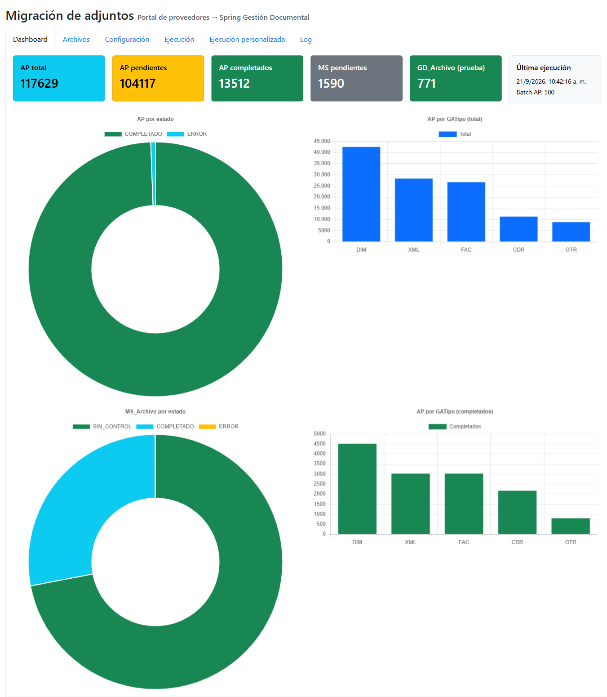
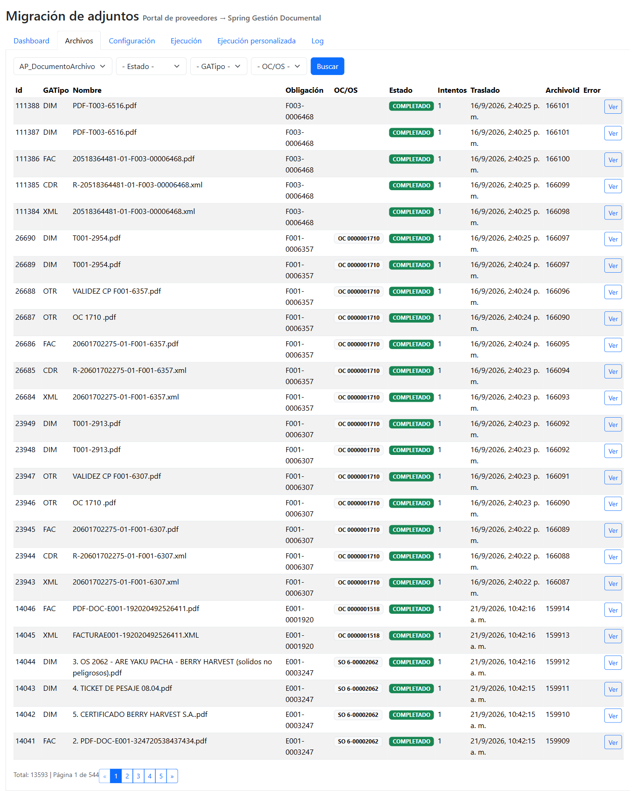
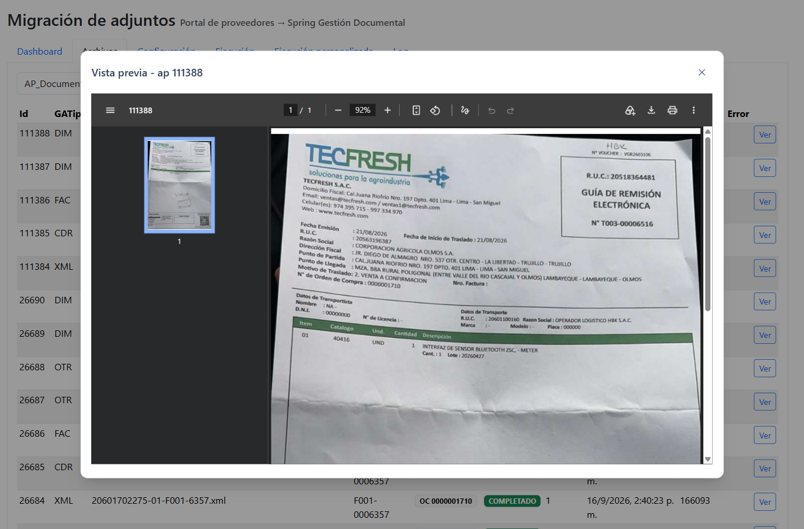
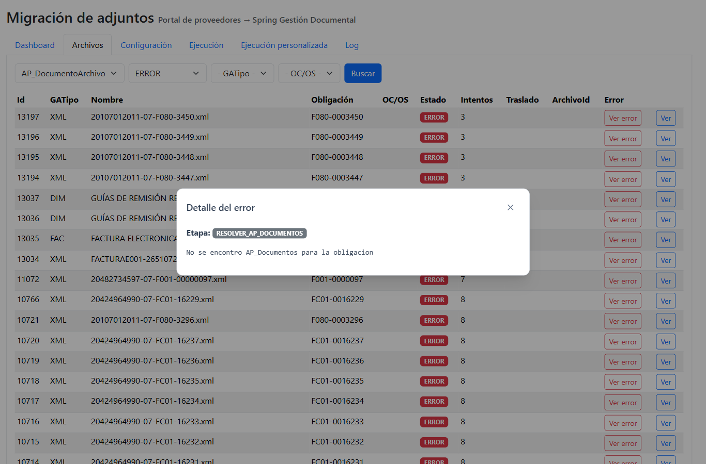
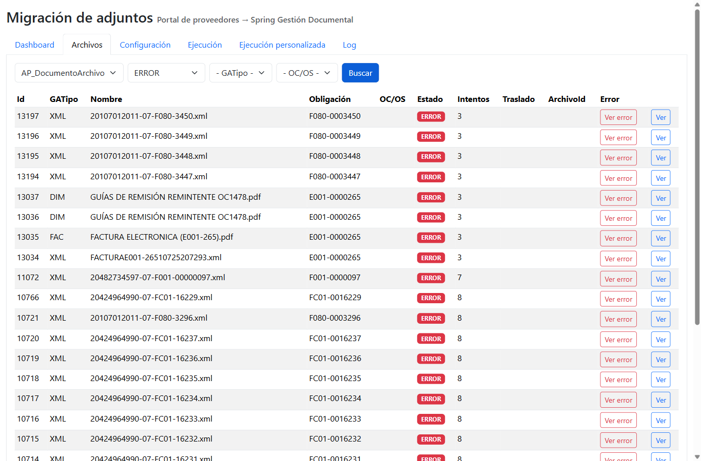
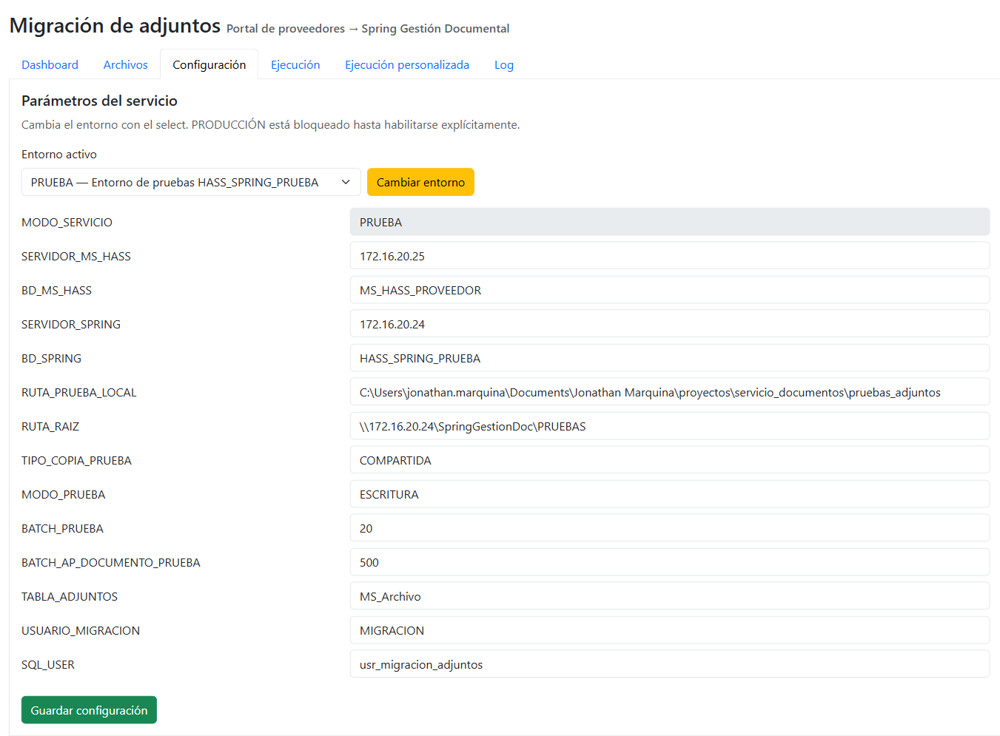
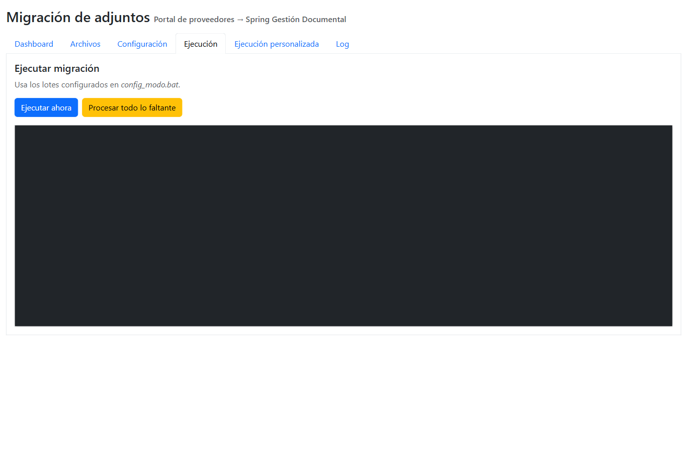
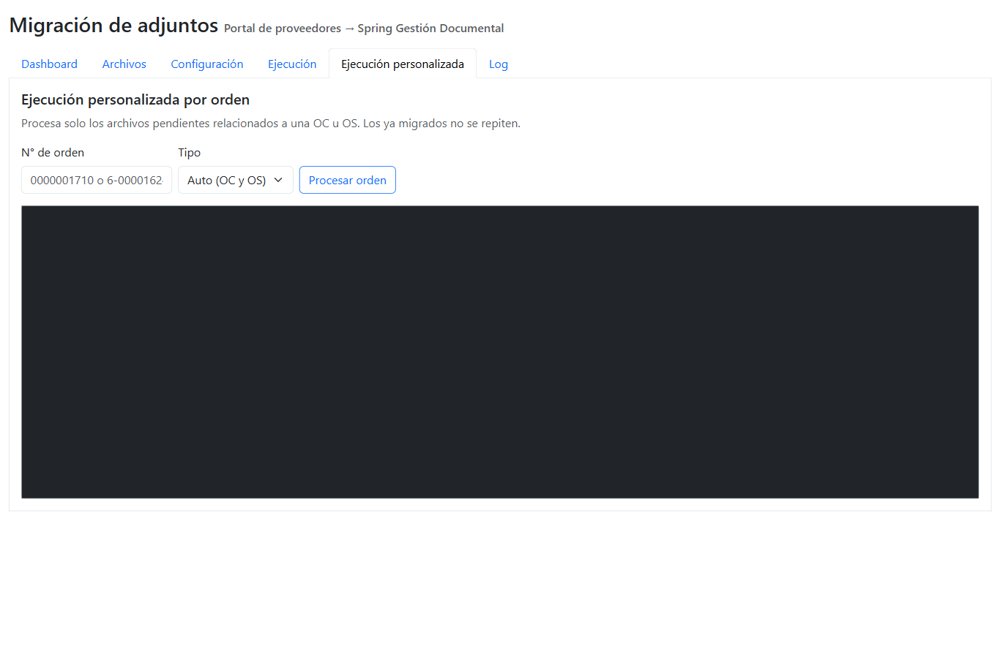
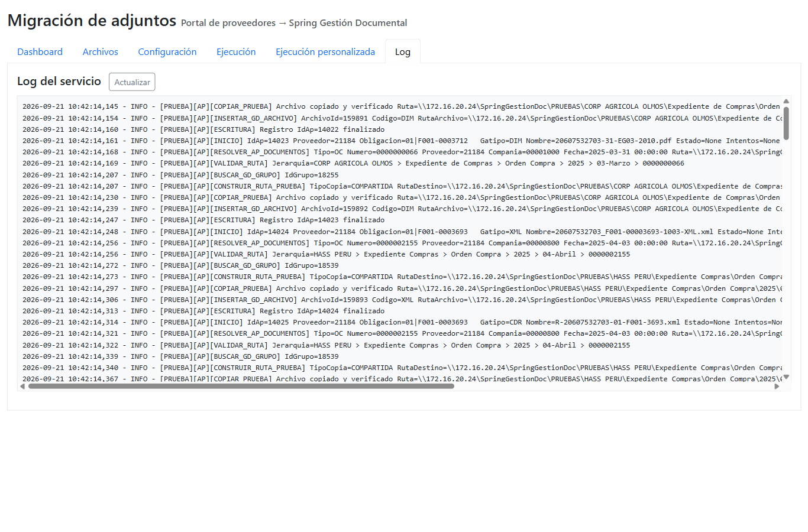

# Manual de usuario — Dashboard web de Migración de Adjuntos

**Aplicación:** Migración de adjuntos — Portal de proveedores → Spring Gestión Documental
**Acceso:** `https://apimigraciondoc.agroapps.net:7631/` (sitio IIS del servidor)
**Perfil de usuario:** personal de soporte / sistemas. No requiere login (herramienta interna).

La aplicación permite **monitorear** el avance de la migración, **revisar** el estado de cada archivo, **ver** los documentos sin descargarlos, **ejecutar** migraciones manuales y **configurar** el servicio.

---

## 1. Pantalla principal — Dashboard

Al ingresar se muestran seis tarjetas de resumen y cuatro gráficos:

| Tarjeta | Significado |
|---|---|
| **AP total** | Archivos registrados en `MS_AP_DocumentoArchivo` (documentos de facturas del portal) |
| **AP pendientes** | Archivos con datos que aún no completan su traslado |
| **AP completados** | Archivos ya migrados a Spring |
| **MS pendientes** | Adjuntos de `MS_Archivo` pendientes de migrar |
| **GD_Archivo (prueba)** | Registros creados por la migración en la base de pruebas de Spring |
| **Última ejecución** | Fecha/hora del último traslado y tamaño del lote AP configurado |

**Gráficos:**

- **AP por estado** (dona): distribución COMPLETADO / ERROR / PENDIENTE.
- **AP por GATipo (total)**: cantidad de archivos por tipo documental (XML, CDR, FAC, DIM, OTR).
- **MS_Archivo por estado** (dona): estado de los adjuntos del portal.
- **AP por GATipo (completados)**: cuántos archivos de cada tipo ya migraron.

---

## 2. Archivos

Lista paginada de todos los archivos con su estado de migración.

### Filtros (parte superior)

| Filtro | Opciones |
|---|---|
| **Tabla** | `AP_DocumentoArchivo` (documentos de facturas) · `MS_Archivo` (adjuntos del portal) |
| **Estado** | PENDIENTE · COMPLETADO · ERROR |
| **GATipo** (solo AP) | XML · CDR · FAC · DIM · OTR |
| **OC/OS** (solo AP) | OC (orden de compra) · OS (orden de servicio) |

Pulse **Buscar** para aplicar los filtros.

### Columnas

- **Id**: identificador del archivo.
- **GATipo**: tipo documental (factura XML, CDR, FAC = PDF de factura, DIM = documento de identidad/adjunto, OTR = otros).
- **Nombre**: nombre físico del archivo.
- **Obligación**: número de factura/documento del proveedor (ej. `F001-0006357`).
- **OC/OS**: orden de compra o servicio relacionada (ej. `OC 0000001710`, `SO 6-00002062`). Puede mostrar varias.
- **Estado**: badge con el estado actual (verde = COMPLETADO, rojo = ERROR, amarillo = PENDIENTE).
- **Intentos**: cuántas veces se ha intentado migrar.
- **Traslado**: fecha del traslado completado.
- **ArchivoId**: identificador asignado en `GD_Archivo` de Spring.
- **Error / acciones**: botones **Ver** y **Ver error**.

Al pie se muestra el total de registros y el paginador.

### Vista previa de un documento

El botón **Ver** abre un modal con el documento en línea (PDF, XML, imagen) sin necesidad de descargarlo. Si el archivo ya fue migrado, se muestra la copia ya alojada en el destino de Spring.

### Detalle de un error

Para filas en estado **ERROR**, el botón **Ver error** muestra un modal con:

- **Etapa**: fase del proceso donde ocurrió el fallo (ej. `RESOLVER_AP_DOCUMENTOS`, `COPIAR_PRUEBA`).
- **Mensaje**: causa técnica o funcional (ej. "No se encontró AP_Documentos para la obligación").

Los archivos en ERROR **se reintentan automáticamente** en la siguiente corrida del servicio.

---

## 3. Configuración

### Entorno activo

- El selector muestra el entorno actual (**PRUEBA** o **PRODUCCION**).
- **Cambiar entorno** aplica el cambio y regenera los archivos de configuración del servicio.
- **PRODUCCION permanece bloqueado** hasta que se habilite explícitamente en la base de datos (`Entornos_Migracion.ProduccionHabilitado`). Cada cambio queda auditado.

### Parámetros del servicio

| Parámetro | Descripción |
|---|---|
| `MODO_SERVICIO` | Entorno del servicio (PRUEBA) |
| `SERVIDOR_MS_HASS` / `BD_MS_HASS` | Servidor y base del portal de proveedores |
| `SERVIDOR_SPRING` / `BD_SPRING` | Servidor y base de Spring |
| `RUTA_PRUEBA_LOCAL` | Carpeta local para copias de prueba |
| `RUTA_RAIZ` | Raíz UNC destino (`\\172.16.20.24\SpringGestionDoc\PRUEBAS`) |
| `TIPO_COPIA_PRUEBA` | `LOCAL` o `COMPARTIDA` |
| `MODO_PRUEBA` | `SIMULACION` (solo lectura) o `ESCRITURA` (registra control y GD_Archivo) |
| `BATCH_PRUEBA` | Archivos `MS_Archivo` por corrida |
| `BATCH_AP_DOCUMENTO_PRUEBA` | Archivos `MS_AP_DocumentoArchivo` por corrida |
| `TABLA_ADJUNTOS` | Tabla origen de adjuntos |
| `USUARIO_MIGRACION` | Usuario registrado en las inserciones (`UltimoUsuario`) |
| `SQL_USER` | Usuario SQL del servicio (la contraseña **no** se muestra ni edita aquí) |

**Guardar configuración** valida los valores antes de aplicar: en PRUEBA exige `BD_SPRING = HASS_SPRING_PRUEBA` y la raíz `...\PRUEBAS`; valores inválidos se rechazan con el detalle del error.

---

## 4. Ejecución

Ejecución manual del servicio con los lotes configurados:

- **Ejecutar ahora**: corre una migración inmediata procesando hasta `BATCH_PRUEBA` adjuntos y `BATCH_AP_DOCUMENTO_PRUEBA` archivos AP.
- **Procesar todo lo faltante**: ajusta los lotes al total de pendientes y corre una sola vez (puede tardar bastante según el volumen).

El panel negro muestra la **salida en vivo** del proceso (se actualiza cada 2 segundos) con inicio, fin y duración.

> Solo se puede ejecutar en modo PRUEBA. La API rechaza ejecuciones manuales en PRODUCCION.

---

## 5. Ejecución personalizada

Procesa **únicamente** los archivos pendientes relacionados a una orden de compra o servicio:

1. **N° de orden**: número de OC (ej. `0000001710`) u OS (ej. `6-00001624`).
2. **Tipo**: `Auto` (busca en OC y OS), `OC` u `OS`.
3. **Procesar orden**: primero informa cuántas obligaciones (facturas) componen la orden y cuántos archivos pendientes tiene; luego lanza la migración filtrada. Si todo ya está migrado, avisa que no hay pendientes.

**Uso típico:** cuando el proveedor adjunta archivos nuevos a una OC/OS ya migrada y se quiere sincronizar de inmediato sin esperar la tarea programada de cada 2 horas.

---

## 6. Log del servicio

Muestra las últimas líneas de `migrar_adjuntos_spring_prueba.log`. Cada línea incluye fecha/hora, nivel, etapa (`[INICIO]`, `[RESOLVER_AP_DOCUMENTOS]`, `[VALIDAR_RUTA]`, `[BUSCAR_GD_GRUPO]`, `[COPIAR_PRUEBA]`, `[INSERTAR_GD_ARCHIVO]`, `[ESCRITURA]`, `[RESUMEN]`) e identificadores del archivo procesado.

Use **Actualizar** para recargar. Busque las marcas `[FALLIDO]` para localizar errores y `[RESUMEN]` para el total de cada corrida.

---

## 7. Estados de un archivo

| Estado | Significado |
|---|---|
| PENDIENTE | Registrado para traslado, aún sin procesar |
| PROCESANDO | En ejecución en este momento |
| COMPLETADO | Copiado al destino y registrado en `GD_Archivo` |
| ERROR | Falló; el detalle muestra etapa y mensaje. Se reintenta solo en la siguiente corrida |
| SIN_CONTROL | Existe en el portal pero aún no tiene registro de traslado |

## 8. Preguntas frecuentes

**¿Los archivos ya migrados se vuelven a procesar?**
No. Los COMPLETADO nunca se repiten. Un archivo nuevo con el mismo nombre se guarda con sufijo `_001`, `_002`, etc.; uno idéntico se omite.

**¿Qué pasa si el portal adjunta archivos a una orden ya migrada?**
Aparecen como pendientes y se copian a la misma carpeta de la orden en la siguiente corrida (cada 2 horas), o de inmediato con *Ejecución personalizada*.

**¿Puedo ejecutar en producción desde aquí?**
No. El dashboard solo permite ejecuciones en PRUEBA. Producción requiere aprobación formal y habilitación en base de datos (ver `03_PROCEDIMIENTO.md`, sección 7).

**¿Qué hago con los archivos en ERROR?**
Filtre Estado = ERROR en *Archivos*, pulse **Ver error** y revise la etapa. La mayoría se resuelven regularizando el dato en Spring (ej. falta `AP_Documentos` o `RutaArchivo`); el reintento es automático. La tabla de causas por etapa está en `03_PROCEDIMIENTO.md`, sección 3.
