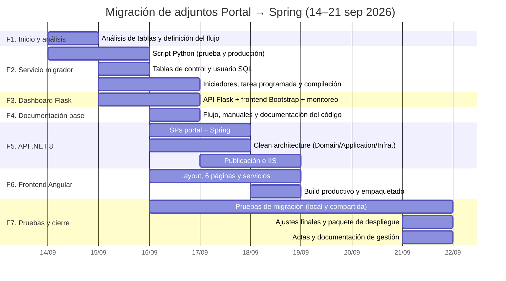

# Cronograma y diagrama de Gantt — Migración de adjuntos a Spring

**Periodo del proyecto:** lunes 14/09/2026 → lunes 21/09/2026
**Duración:** 8 días calendario · 6 días hábiles (19–20/09 fue fin de semana)

> Las fechas se reconstruyeron del historial de Git y las marcas de tiempo de los archivos del proyecto.

## 1. Diagrama de Gantt



### Vista alternativa (sin Mermaid)

```
Día          │ 14 │ 15 │ 16 │ 17 │ 18 │ 19-20 │ 21 │
─────────────┼────┼────┼────┼────┼────┼───────┼────┤
F1 Análisis  │ ██ │    │    │    │    │       │    │
F2 Servicio  │ ██ │ ██ │ ██ │    │    │       │    │
F3 Flask     │    │ ██ │ ██ │    │    │       │    │
F4 Doc base  │    │    │ ██ │    │    │       │    │
F5 API .NET  │    │    │ ██ │ ██ │ ██ │       │    │
F6 Angular   │    │    │ ██ │ ██ │ ██ │       │    │
F7 Pruebas   │    │    │ ██ │ ██ │ ██ │       │ ██ │
F7 Cierre    │    │    │    │    │    │       │ ██ │
```

## 2. Cronograma detallado por día

| Fecha | Día | Actividades realizadas (evidencia) |
|---|---|---|
| **14/09/2026** | Lun | Inicio: análisis de `MS_Archivo`/`AP_Documentos`, primera versión del script de migración, primeras ejecuciones de prueba (log inicial) |
| **15/09/2026** | Mar | Servicio completo en modo prueba; creación de tablas de control (`MS_ArchivoTraslado`, `MS_AP_DocumentoArchivoTraslado`); usuario SQL `usr_migracion_adjuntos`; scripts de conexión e iniciadores; dashboard Flask con monitoreo, entornos dinámicos, preview y correcciones (13 commits); tarea programada |
| **16/09/2026** | Mié | Documento de flujo (`FLUJO_MIGRACION_ADJUNTOS.md`); docs 02–05; tablas de entornos del dashboard; **inicio de la migración tecnológica**: proyecto Angular 20 y API .NET 8; primeras pruebas compartidas |
| **17/09/2026** | Jue | Desarrollo de la API (controller, use case, repositorios, RunManager); SPs `sp_mig_*` del portal; `dotnet publish`; `web.config` para IIS; script de despliegue al servidor; avances Angular |
| **18/09/2026** | Vie | `appsettings.Production`; build productivo de Angular; pruebas de la API en dev; paquete `api_migracion_doc` publicado |
| **19–20/09/2026** | Fin de semana | Sin actividad de desarrollo; servicio operando por tarea programada |
| **21/09/2026** | Lun | Compilación final de ejecutables (`migrar_prueba.spec`, `migrar_produccion.spec`); ajustes del servicio de prueba; publicación final de la API; documentación de gestión y manual ilustrado |

## 3. Hitos

| Hito | Fecha |
|---|---|
| Inicio del proyecto | 14/09/2026 |
| Servicio migrador operativo en PRUEBA | 15/09/2026 |
| Dashboard Flask funcional | 15/09/2026 |
| Flujo documentado y aprobado para pruebas | 16/09/2026 |
| API .NET 8 publicada | 17–18/09/2026 |
| Frontend Angular productivo | 18/09/2026 |
| Paquete de despliegue y cierre de desarrollo | 21/09/2026 |
| **Pendiente:** habilitación de producción | Tras aprobación formal |

## 4. Dependencias entre actividades

- La API .NET y el frontend Angular dependen del flujo ya estabilizado del servicio migrador.
- La publicación en IIS depende de la API y del build de Angular (`wwwroot`).
- Las pruebas compartidas (`TIPO_COPIA_PRUEBA=COMPARTIDA`) dependen de los permisos de red de la cuenta de la tarea.
- El pase a producción depende del checklist de `03_PROCEDIMIENTO.md` §7 (no programado en este cronograma).
